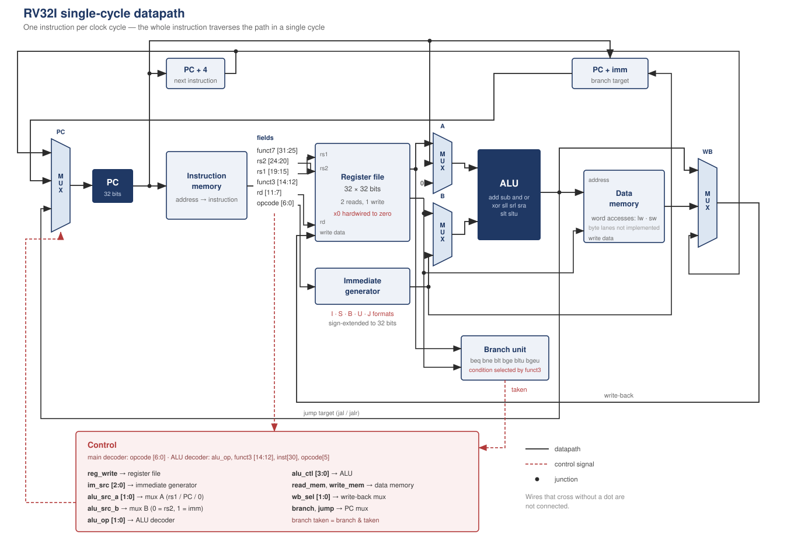

# RV32I Single-Cycle Core

A 32-bit RISC-V processor implementing the RV32I base integer instruction set,
written in Verilog from the specification and validated on a Xilinx Zynq-7000.



---

## Status

The core executes RISC-V programs. It has been verified module by module
(154 directed test vectors), then end to end on a program exercising
arithmetic, conditional branches, a backward jump and memory access.

It has been synthesised, placed and routed for the XC7Z020, meeting a 50 MHz
constraint with 7.9 ns of slack.

**Not yet run on hardware.** The bitstream is generated; the board bring-up
is pending.

---

## Architecture

Single-cycle: one instruction completes per clock edge. Harvard organisation,
with separate instruction and data memories at one-cycle latency.

| Module | Role |
|---|---|
| `core.v` | Assembly: instantiations, wiring, four multiplexers |
| `pc.v` | Program counter, synchronous reset |
| `imem.v` | Instruction memory, 256 words, loaded with `$readmemh` |
| `control.v` | Main decoder: opcode to ten control signals |
| `aluControl.v` | ALU decoder: `alu_op`, `funct3`, `inst[30]`, `opcode[5]` to operation |
| `imGen.v` | Immediate generator, five formats (I, S, B, U, J) |
| `regFile.v` | 32 × 32-bit registers, two read ports, `x0` hardwired to zero |
| `alu.v` | Ten operations, zero flag |
| `branch_unit.v` | Six branch conditions, signed and unsigned |
| `dmem.v` | Data memory, 256 words |

### Design decisions

**Three sources on ALU input A** — `rs1_data`, the PC, or zero. This handles
`lui` as `0 + imm` and `auipc` as `PC + imm` without adding an ALU operation.

**One jump target** — for both `jal` and `jalr` the target is the ALU result,
since `control.v` selects the PC as ALU input A for `jal`. The PC multiplexer
therefore needs three inputs, not four.

**Distributed RAM, not block RAM** — the register file needs two asynchronous
read ports, which 7-series BRAM cannot provide. Synthesis maps the register
file and both memories into LUTs.

**No cache** — memory responds in one cycle, so a cache would accelerate
nothing. A cache only becomes meaningful once a pipeline can stall.

---

## Verification

Each module has a self-checking testbench that reports PASS/FAIL per vector
and counts errors.

| Module | Vectors | Notable cases |
|---|---|---|
| `alu` | 26 | arithmetic right shift, signed vs unsigned comparison, shift-amount masking |
| `regFile` | 14 | `x0` stays zero after a write attempt, write-enable gating |
| `imGen` | 14 | real encoded instructions, the ±2047 boundaries, B and J formats |
| `control` | 10 | all nine opcodes plus an invalid one |
| `aluControl` | 25 | `addi` with `inst[30]` set must not become `sub` |
| `pc` | 9 | reset priority, value held between edges |
| `imem` | 13 | word addressing: four byte addresses map to one instruction |
| `dmem` | 14 | last word of memory, write-enable gating |
| `branch_unit` | 22 | identical operands, opposite verdicts for `blt` and `bltu` |
| `core` | 7 | end-to-end program execution |

Every testbench was additionally checked by deliberately breaking the module
under test and confirming the failure was reported.

### End-to-end test

The program computes 1+2+3+4+5 in a loop, stores the result, reads it back,
then halts on a jump to itself.

```
 0   addi x1, x0, 0       sum = 0
 4   addi x2, x0, 1       i = 1
 8   addi x3, x0, 6       limit
12   beq  x2, x3, 28      exit if i == 6
16   add  x1, x1, x2      sum += i
20   addi x2, x2, 1       i++
24   jal  x0, -12         loop
28   sw   x1, 0(x0)       mem[0] = sum
32   lw   x4, 0(x0)       x4 = mem[0]
36   addi x5, x0, 99      end marker
40   jal  x0, 0           halt
```

Execution trace:

```
  cyc   PC  instruction   x1  x2  x3  x4  x5   mem[0]
    3   12  00310863       0   1   6   x   x   x     branch not taken
    6   24  ff5ff06f       1   2   6   x   x   x     backward jump
    7   12  00310863       1   2   6   x   x   x     PC returned to 12
   21   20  00110113      15   5   6   x   x   x     sum complete
   23   12  00310863      15   6   6   x   x   x     i == limit
   24   28  00102023      15   6   6   x   x   x     branch taken
   25   32  00002203      15   6   6   x   x   15    sw executed
   26   36  06300293      15   6   6  15   x   15    lw executed
   27   40  0000006f      15   6   6  15  99   15    marker
   28   40  0000006f      15   6   6  15  99   15    halted

  OK     x1 = 15
  OK     x4 = 15
  OK     mem[0] = 15
  OK     PC = 40  (halted)
  RESULT : loop, branches and memory work
```

---

## Synthesis results

Target: Xilinx Zynq-7000 **XC7Z020-2**, Vivado 2018.3.

| Resource | Used | Available | Util. |
|---|---|---|---|
| Slice LUTs | 557 | 53 200 | 1.05 % |
| — as logic | 381 | | |
| — as distributed RAM | 176 | 17 400 | 1.01 % |
| Slice Registers | 32 | 106 400 | 0.03 % |
| Block RAM | 0 | 140 | 0 % |
| DSP | 0 | 220 | 0 % |

Only 32 flip-flops: the program counter. The register file and both memories
are mapped to distributed RAM, as the asynchronous reads of a single-cycle
design require.

### Timing

| | |
|---|---|
| Constraint | 20.000 ns (50 MHz) |
| WNS | **+7.919 ns** |
| TNS | 0.000 ns |
| WHS | +0.277 ns |
| Critical path | 12.081 ns |
| **Maximum frequency** | **≈ 82 MHz** |

All user-specified timing constraints are met.

---

## Limitations

Stated plainly, because a reader should know what this does not do.

**31 of the 37 RV32I instructions are fully implemented.** The data memory
exposes word accesses only, so `lb`, `lh`, `lbu`, `lhu`, `sb` and `sh` are
decoded but operate on full words. Byte lanes are not implemented.

**`fence`, `ecall` and `ebreak` are decoded as no-ops.** There is no
privileged mode, no CSR file, no trap handling.

**No cache, no pipeline, no branch prediction.** A single-cycle core has no
use for any of them, and their absence is deliberate rather than pending.

**Never run on hardware.** All figures above come from simulation and from
the Vivado implementation reports. No measurement on a physical board.

**Memory sizes are 256 words each**, enough for the test programs and nothing
more.

---

## Next step: the pipeline

The natural extension is a five-stage pipeline, and it is worth stating why it
matters beyond performance.

The core is single-cycle: every instruction takes exactly one cycle, and its
duration depends on no internal state. That property eliminates timing side
channels by construction — at the cost of a clock period bounded by the
critical path.

A pipeline introduces a dependence between execution time and history: stalls
on load-use hazards, flushes on mispredicted branches. That dependence is
exactly what microarchitectural side-channel attacks exploit, and what work on
dynamic execution contexts seeks to partition.

Adding a pipeline therefore means adding the attack surface. It is the right
next step, and the right place to start thinking about isolation.

---

## Running it

Simulation requires only Icarus Verilog or Vivado's XSim.

```sh
iverilog -o core.out tb/core_tb.v rtl/*.v
vvp core.out
```

Under Vivado, add `rtl/` as design sources, `tb/` as simulation sources, set
the simulation top to the testbench you want, and run behavioural simulation.
The `$readmemh` path in `imem.v` must point at `sw/programme.hex`.

For synthesis, set `core` as the top module and add `constraints/timing.xdc`.

---

## References

A. Waterman and K. Asanović, *The RISC-V Instruction Set Manual, Volume I:
Unprivileged ISA*. Chapter 2 covers RV32I in full; the encoding tables are in
the appendix.

---

Written by Wendyam Clovis Dubois Zongo as an independent study of RISC-V
microarchitecture. Every module was written from the specification; no
third-party RTL was used.
